# Observatório INPE · H3

> **Visualização atual:** total acumulado por H3, com filtro opcional de últimos N minutos. Consulte [configuração do índice e atualização da Lambda](docs/VISUALIZACAO_TEMPO.md). As consultas por dia/dez minutos descritas abaixo permanecem como API de compatibilidade.

Pipeline de focos de calor com produtor na sua máquina, dados brutos do INPE, consolidação cronológica, S3, SQS FIFO, Lambda consumidora, agregação H3, DynamoDB e mapa em D3.

## Arquitetura e fluxo dos dados

A arquitetura separa a **ingestão**, que começa na sua máquina e grava na AWS, da **visualização**, em que o navegador consulta uma Lambda pública. O mapa pode ser hospedado na Vercel ou em qualquer serviço de arquivos estáticos; ele não depende de um servidor local nem recebe credenciais AWS.

```mermaid
flowchart LR
    INPE["INPE · arquivos CSV de 10 minutos"]

    subgraph LOCAL["Sua máquina · produtor Python"]
        SCRAPE["Download e normalização"]
        SQL["SQLite · registros, deduplicação e checkpoints"]
        CSV["CSV consolidado · ordenado por data UTC"]
        STREAM["Leitura do S3 em streaming"]
        SCRAPE --> SQL --> CSV
        SQL -. "ignora IDs já enviados" .-> STREAM
    end

    subgraph AWS["AWS · região sa-east-1"]
        S3["S3 privado · snapshots do dataset"]
        Q["SQS FIFO · 1 a 10 registros por mensagem"]
        CONSUMER["Lambda consumidora · H3"]
        DLQ["SQS DLQ · mensagens com falha"]
        DB["DynamoDB · observações e grupos de 10 min"]
        INDEX["GSI ObservationsByTime · consulta por horário"]
        API["Lambda de consulta · Function URL pública"]
        Q -->|"1 mensagem por invocação"| CONSUMER
        Q -->|"após 5 recebimentos sem sucesso"| DLQ
        CONSUMER -->|"transação: observação + contador"| DB
        DB -->|"indexação automática"| INDEX
        API -->|"Query · leitura apenas"| INDEX
        INDEX -->|"observações do período"| API
    end

    HOST["Vercel ou outra hospedagem estática"]
    MAP["Navegador · mapa D3"]

    INPE --> SCRAPE
    CSV -->|"upload · --scrape"| S3
    S3 -->|"download em stream · --start"| STREAM
    STREAM -->|"envio com pausa configurável"| Q
    HOST -->|"HTML, CSS e JavaScript"| MAP
    MAP -->|"GET HTTPS · polling a cada 5 s"| API
    API -->|"GeoJSON paginado"| MAP
```



### 1. Fonte de dados: INPE

O produtor acessa a listagem pública do INPE e identifica os CSVs disponíveis. Esses arquivos representam intervalos de publicação de dez minutos e contêm latitude, longitude, satélite e data/hora da observação. A periodicidade de publicação é independente da frequência com que o mapa consulta a API. A fonte possui uma janela de retenção: baixar todos os arquivos disponíveis não significa baixar todo o histórico de queimadas do INPE.

### 2. Produtor local: download, consolidação e S3

Com `--scrape`, o produtor baixa os arquivos para `data/raw/`, normaliza datas em UTC e registra as observações no SQLite. O banco local remove duplicatas e permite ordenar os registros em disco, sem carregar todo o dataset na memória. Em seguida, gera `data/consolidated.csv` em ordem cronológica e envia um snapshot ao S3 privado.

O caminho do snapshot inclui o SHA-256 do conteúdo: `consolidated/<sha256>.csv`. A referência do último upload concluído fica em `data/s3-dataset.json`; é ela que conecta a etapa de preparação à etapa de streaming. O SQLite também guarda os arquivos já processados e os checkpoints de envio por fila.

### 3. Streaming local: S3 para SQS

Com `--start`, o produtor abre o snapshot indicado no manifesto e lê o CSV diretamente do S3 como stream. Ele não faz novo scraping nem novo upload nessa etapa. Cada mensagem SQS contém de 1 a 10 observações, conforme `RECORDS_PER_MESSAGE`. A pausa entre mensagens é definida por `READ_INTERVAL_SECONDS`.

Após um envio confirmado, o produtor grava o checkpoint no SQLite. Se houver interrupção entre o envio e o checkpoint, a observação pode ser reenviada; a proteção adicional no consumidor impede que isso duplique sua contagem no DynamoDB.

### 4. Fila FIFO, consumidor e tratamento de falhas

A fila SQS desacopla a velocidade de leitura do produtor da velocidade de processamento da Lambda. Todas as mensagens usam o mesmo `MessageGroupId`, `inpe-chronological`, para preservar a ordem de envio e processar esse grupo sequencialmente. A Lambda recebe uma mensagem por invocação; essa mensagem pode conter até dez observações.

A configuração desejada da atividade é concorrência reservada igual a 1, declarada no template SAM. Na configuração manual desta conta, a reserva ficou como **unreserved** devido à quota disponível; o único grupo FIFO mantém o consumo desse grupo sequencial. Isso não equivale a configurar a reserva da função como 1.

Para cada observação, a Lambda converte latitude/longitude para uma célula H3 na resolução configurada. Mensagens que falham voltam a ser tentadas; após cinco recebimentos sem sucesso, seguem para a DLQ para investigação e eventual reenvio. O consumidor usa `ReportBatchItemFailures` para sinalizar falhas ao SQS.

### 5. Persistência: observações exatas e agregados

O DynamoDB mantém dois tipos de item: a observação deduplicada com seu timestamp exato e o agregado por **intervalo de dez minutos UTC + satélite + hash H3 + resolução**. A inserção da observação e o incremento do contador são feitos na mesma transação. Se a observação já existe, o incremento não é repetido.

Essa separação permite manter os grupos solicitados na atividade e também oferecer filtros temporais mais precisos na visualização. Por exemplo, os últimos sete minutos não podem ser calculados corretamente apenas somando grupos inteiros de dez minutos.

### 6. Lambda pública de consulta e índice temporal

O índice `ObservationsByTime` organiza as observações existentes pela chave de resolução/agregação (`sk`) e pelo timestamp (`date`). A Lambda de consulta usa `Query` nesse índice para obter todo o histórico ou somente as observações dos últimos N minutos, sem executar `Scan`.

A API agrupa cada página por hash H3 e satélite e devolve GeoJSON com contagens e cursor de paginação. Todas as páginas de uma rodada usam o mesmo instante de referência (`as_of`), para que o início do período não mude durante a leitura. Como é um índice secundário global, novas gravações podem levar algum tempo para aparecer nas consultas.

A Function URL fornece o endpoint HTTPS público, sem API Gateway. A Lambda utiliza uma IAM role com permissão de consulta somente na tabela e no índice, além de logs. CORS autoriza as origens do frontend; ele não torna a API privada nem substitui autenticação.

### 7. Website estático e mapa D3

A hospedagem entrega os arquivos da pasta `frontend/` ao navegador. O JavaScript lê a URL pública em `config.js`, consulta a API e percorre todas as páginas. Depois soma os resultados pelo mesmo hash H3, inclusive entre horários e dias distintos, e desenha uma única célula para cada hash.

Por padrão, o mapa mostra **todo o histórico**. Ao ativar **Últimos N minutos**, considera somente observações cujo horário esteja dentro da janela móvel calculada pelo servidor. O filtro usa a data/hora da observação INPE, não o momento em que ela chegou ao SQS. Focos, células ocupadas e satélites são recalculados a partir do mesmo conjunto filtrado.

Uma nova consulta começa cinco segundos após terminar a anterior. Cada rodada substitui os dados exibidos, em vez de somar novamente a resposta anterior. Assim, novas observações aumentam os contadores e observações que saem da janela deixam de contar no modo recente. Em falhas de consulta, o mapa preserva o último resultado e sinaliza que ele pode estar desatualizado.

### Comandos relacionados ao fluxo

| Comando | Etapa executada |
|---|---|
| `python -m producer.main --reset` | Apaga downloads, dataset, registros e checkpoints locais; preserva AWS |
| `python -m producer.main --scrape --max-files 6` | Processa os seis arquivos mais recentes da listagem e envia o consolidado ao S3 |
| `python -m producer.main --start` | Lê o snapshot preparado no S3 e envia observações ainda não enviadas ao SQS |
| `python -m producer.main --scrape --start` | Executa preparação/upload e depois envio à fila |
| `python -m producer.main --scrape --start --watch` | Repete preparação e envio a cada rodada de polling |

Os arquivos e registros locais são cumulativos entre rodadas. `--max-files 6` limita a seleção de novos arquivos da listagem, mas não remove registros anteriores do consolidado. Para um teste local do zero, use `--reset --scrape --max-files 6`; o reset local não limpa o DynamoDB ou o S3.

## Aplicações isoladas

| Diretório | Função | Execução |
|---|---|---|
| `producer/` | Download, consolidação, upload, streaming e envio | Sua máquina, rotina única ou contínua |
| `consumer/` | H3 e persistência idempotente | Lambda acionada pelo SQS |
| `backend/` | Consulta temporal paginada e GeoJSON | Lambda com Function URL pública; servidor local opcional |
| `frontend/` | Mapa Brasil, totais por H3, filtro temporal/satélite e zoom | Website estático, hospedagem independente |
| `common/` | Contrato e normalização das observações | Compartilhado no build |
| `infra/` | Infraestrutura declarativa AWS SAM | CloudFormation |
| `tests/` | Testes de rotina e integração simulada | pytest / Moto |

Para os recursos já criados manualmente: **[Publicar o mapa estático e a Lambda de consulta](docs/MAPA_PUBLICO.md)**.

Para uma instalação nova do pipeline completo: **[Configuração e implantação na AWS](docs/AWS.md)**.

## Decisões do processamento

**Fonte:** [diretório CSV de dez minutos do INPE](https://dataserver-coids.inpe.br/queimadas/queimadas/focos/csv/10min/). Na primeira execução, baixa todos os arquivos que estiverem na listagem. A fonte tem uma janela de retenção: não equivale a todo o acervo histórico do INPE. `--max-files 6` permite um teste com os seis arquivos mais recentes. Quando existir a coluna `pais`/`country`, o produtor filtra Brasil por padrão. O formato real de dez minutos (`lat,lon,satelite,data`) não informa país: nesse caso todas as observações são preservadas e um aviso é registrado, pois não é possível determinar o país somente pelo cabeçalho.

**Rotina:** descobre arquivos → baixa para `data/raw/` → normaliza → deduplica no SQLite → exporta `data/consolidated.csv` em ordem crescente de data UTC → envia para `s3://BUCKET/consolidated/SHA256.csv` → abre o objeto no S3 como stream → envia os registros ainda não enviados para SQS. A ordenação usa `(date, id)` para desempate determinístico. O CSV consolidado é único localmente; o S3 guarda snapshots identificados por conteúdo. Os CSVs brutos permanecem locais.

**Memória:** downloads e leitura do S3 usam blocos; a ordenação fica a cargo de um índice SQLite em disco. O produtor não precisa carregar todos os CSVs em um DataFrame. `RECORDS_PER_MESSAGE` determina os registros por mensagem (1–10); `READ_INTERVAL_SECONDS` determina a pausa entre mensagens. São conceitos diferentes do tamanho do lote de mensagens entregue à Lambda, configurado como **1 mensagem por invocação**.

**Retomada:** o SQLite guarda arquivos processados e IDs enviados por URL de fila. Após cada envio confirmado, registra o checkpoint. Se cair entre o envio e o checkpoint, pode reenviar; a Lambda evita a duplicação no banco. O bloqueio local impede duas instâncias com o mesmo `DATA_DIR` (Linux/macOS). Use apenas um produtor por fila para preservar a sequência. Os arquivos publicados são tratados como imutáveis; correções de arquivos já baixados exigem revisão do cache/estado.

**Datas:** datas INPE sem fuso são interpretadas como GMT/UTC, conforme a [descrição de atributos do INPE](https://www.terrabrasilis.dpi.inpe.br/queimadas/portal/pages/secao_informacoes/faq/index.html). Todas são normalizadas para ISO 8601 UTC. O dataset é ordenado por instante, não pelo nome do CSV. No modo contínuo, cada snapshot é ordenado; arquivos atrasados podem trazer observações anteriores às já enviadas. A fila preserva a ordem de envio, não corrige atrasos da fonte.

**H3:** `latlng_to_cell(latitude, longitude, resolution)` agrupa pontos em uma grade geográfica, conforme a [API H3](https://h3geo.org/docs/api/indexing/). Resolução padrão 5. Não é DBSCAN nem identificação de incêndios: cada cluster é **intervalo de dez minutos UTC + satélite + célula H3 + resolução**. Observações em células adjacentes continuam sendo grupos distintos.

**Janelas:** a data/hora da observação determina intervalos fixos `[início, fim)` em UTC: 15:40:00 até antes de 15:50:00 pertence ao grupo `15:40`; 15:50:00 inicia o próximo grupo. O horário exato continua preservado na observação. O campo `date` do agregado contém o início completo do intervalo, e `window_end` seu fim exclusivo, incluindo a virada do dia.

**DynamoDB:** uma tabela, dois tipos de item:

| Item | `pk` | `sk` | Atributos |
|---|---|---|---|
| Agregado | `DAY#2026-11-10` | `RES#5#WINDOW10M#2026-11-10T15:40:00Z#H3#<hash>#SAT#AQUA` | `date` (início UTC), `window_end` (fim exclusivo), `satellite`, `h3`, `resolution`, `count`, `updated_at` |
| Observação/deduplicação | `EVENT#<sha256>` | `RES#5#WINDOW10M` | data/hora exata, satélite, coordenadas, H3, ID |

O ID é SHA-256 de data/hora, satélite e coordenadas com oito casas decimais. Duas linhas iguais nesses campos contam como uma observação, mesmo vindas de arquivos diferentes. A gravação do marcador e o incremento são uma transação atômica. Marcadores não expiram, para que replays antigos continuem idempotentes; o armazenamento cresce com as observações. Não apague marcadores isoladamente.

**Consulta:** a visualização atual usa `Query` no índice `ObservationsByTime`, com paginação e consistência eventual, para somar observações por H3 em todo o histórico ou nos últimos N minutos. As consultas legadas por `day`/`window` continuam lendo os agregados diretamente na tabela com leitura consistente. O backend converte bordas H3 para GeoJSON; o frontend combina as contagens entre páginas. Sempre siga `next_cursor`, mesmo se uma página estiver vazia.

**Mapa:** usa D3, projeção Mercator e limite nacional do [World Atlas](https://github.com/topojson/world-atlas). Células são recortadas visualmente pelo Brasil; os contadores incluem todas as observações recebidas para o intervalo/satélite, inclusive fora do Brasil quando o CSV não informa país. O recorte visual não é um filtro geográfico das observações. O mapa mostra todo o histórico somado por hash H3. O filtro opcional de últimos N minutos consulta timestamps exatos das observações, inclusive atravessando dias. O mapa soma satélites por célula dentro do período escolhido quando selecionado “Todos”. A consulta é refeita a cada cinco segundos após concluir a anterior, aproximando tempo real; a fonte é atualizada a cada dez minutos. A paginação durante novas escritas não representa um snapshot transacional de todo o dia, convergindo na próxima atualização. D3, TopoJSON e a malha são carregados de CDN e precisam de internet. Sem filtro temporal, todos os dados indexados são exibidos.

## Executar o produtor

Python **3.12** recomendado (mesma versão das imagens Lambda).

```bash
python3.12 -m venv .venv
source .venv/bin/activate
python -m pip install -r producer/requirements.txt

# Apenas baixar e consolidar; não requer credenciais AWS.
python -m producer.main --prepare-only --max-files 6

# Depois da implantação e da configuração das variáveis AWS:
export S3_BUCKET='OUTPUT-BucketName'
export SQS_QUEUE_URL='OUTPUT-QueueUrl'
export RECORDS_PER_MESSAGE=10
export READ_INTERVAL_SECONDS=1
python -m producer.main --scrape --start --watch
```

`--watch` repete a rotina a cada `POLL_SECONDS` (padrão 600 s), contado após concluir a rodada. Sem essa opção, executa uma única rodada. Para automatizar com cron, execute sem `--watch`, com diretório de trabalho e ambiente configurados; não rode cron e `--watch` simultaneamente. Linhas inválidas interrompem a ingestão do arquivo, registram nome/linha e preservam os demais checkpoints; não são descartadas silenciosamente. O formato `lat,lon,satelite,data` é aceito sem exigir país. Cabeçalhos aceitos também incluem `data_hora_gmt`, `satelite`, `lat`, `lon`, `pais` e variantes documentadas como `DataHora`, `Latitude`, `Longitude`.

## Executar o backend local

```bash
python -m pip install -r backend/requirements.txt
export TABLE_NAME='OUTPUT-TableName'
export AWS_DEFAULT_REGION=sa-east-1
export AWS_PROFILE=inpe-local
export H3_RESOLUTION=5
python -m uvicorn backend.app:app --host 127.0.0.1 --port 8000
```

Abra **http://127.0.0.1:8000**. Somente para executar o backend local contra o banco, o perfil precisa de `dynamodb:Query` na tabela; o perfil mínimo do produtor não inclui essa permissão. O servidor local é opcional. A publicação usa `backend.handler.handler` em uma Lambda com Function URL pública e o frontend em hospedagem estática. O browser consulta a URL em `frontend/config.js`, sem usuário AWS local. O SAM empacota a Lambda de consulta separadamente, sem FastAPI ou frontend na imagem.

API:

```text
GET /api/health
GET /api/clusters?view=all
GET /api/clusters?view=recent&minutes=60
GET /api/clusters?day=2026-11-10&limit=500
GET /api/clusters?day=2026-11-10&window=15:40
GET /api/clusters?day=2026-11-10&satellite=AQUA&cursor=<next_cursor>
GET /docs  # somente no servidor FastAPI opcional
```

## Testes

```bash
python -m pip install -r requirements-dev.txt
python -m pytest -q tests
node --check frontend/app.js
```

Os testes de integração usam Moto e H3 real: verificam transações idempotentes, reentrega após falha parcial, comportamento FIFO, paginação e GeoJSON. Quando essas dependências não estão instaladas, o módulo de integração é explicitamente pulado. Os testes do produtor usam streams e clientes falsos, sem acesso à AWS/INPE.

## Limites e operação

- A configuração AWS deve ser aplicada na sua conta; este repositório não inclui credenciais.
- `infra/template.yaml` cria uma Function URL pública para leitura dos agregados, com CORS controlado por `FrontendOrigin` e output `ApiUrl`. O website é publicado separadamente. CORS não autentica chamadas; dados são públicos e invocações geram cobrança.
- Uma partição por dia é simples para a atividade. Volumes muito maiores podem exigir shards por região/célula, além de cache e atualização incremental no frontend. O mapa atual lê todas as observações do período pelo índice a cada rodada e agrega por H3; o modo total percorre o histórico inteiro.
- Para reconstruir em outra resolução, altere `H3Resolution` em ambas as Lambdas e reenvie o dataset usando um novo `DATA_DIR` ou limpando somente os checkpoints `sent`, com o produtor parado. A chave de deduplicação inclui resolução; isso permite reprocessar sem misturar as contagens antigas.
- A DLQ recebe mensagens que falharem cinco vezes. Isso permite avançar a fila após a falha, mas perde a ordem estrita em relação à mensagem que foi isolada. Corrija a causa antes de fazer redrive.

## Atualizar a versão que agrupava por dia

Reimplante consumidor e backend juntos. Os novos agregados e marcadores usam o namespace `WINDOW10M`, isolado dos itens diários antigos. O backend consulta somente os novos itens, portanto não soma dados diários com intervalos de dez minutos. Os dados antigos não são convertidos automaticamente.

Para popular os novos intervalos com o dataset já baixado, pare o produtor e limpe **somente os checkpoints de envio**:

```bash
python3 - <<'PYTHON'
import os
import sqlite3
from pathlib import Path
path = Path(os.getenv('DATA_DIR', 'data')) / 'state.sqlite3'
if not path.is_file():
    raise SystemExit(f'Estado não encontrado: {path}')
with sqlite3.connect(path) as db:
    db.execute('DELETE FROM sent WHERE destination = ?', (os.environ['SQS_QUEUE_URL'],))
PYTHON
python -m producer.main --scrape --start --watch
```

Faça uma cópia de segurança do SQLite antes da limpeza. Se a versão diária ainda estiver processando mensagens, aguarde a fila esvaziar ou pause o consumo durante a atualização coordenada. O novo consumidor pode ler o mesmo contrato de mensagem; a deduplicação por observação/resolução/`WINDOW10M` impede contagem repetida durante o replay. Os dados diários antigos podem permanecer na tabela, mas não aparecem na API nova.

## Website estático + Function URL

A Lambda de consulta tem somente permissão `dynamodb:Query`, além dos logs. O consumidor e o produtor permanecem independentes. O frontend chama `GET /api/clusters` na URL pública e não usa SDK AWS ou credenciais. No console, crie a Function URL com autenticação `NONE` e CORS para a origem do frontend. Detalhes, pacotes e permissões públicas estão no [guia do mapa](docs/MAPA_PUBLICO.md).

```bash
# No CloudShell, após enviar e extrair artifacts/inpe-api-source.zip:
bash scripts/build-backend-zip.sh
# Gera dist/inpe-api.zip; handler backend.handler.handler.
python3 scripts/build-frontend.py --api-url 'https://ID.lambda-url.sa-east-1.on.aws/'
# Gera dist/inpe-mapa.zip para upload manual no Amplify Hosting.
```

O pacote de fontes pode ser montado offline, mas o ZIP final da Lambda requer download das dependências. O frontend usa caminhos relativos para os assets e pode ser servido por qualquer hospedagem estática. `apiBaseUrl` vazio preserva o uso com o servidor local; na hospedagem estática configure a URL real ou use o script de empacotamento acima.

## Reset test data

Use [`scripts/reset_aws_data.py`](scripts/reset_aws_data.py) to empty DynamoDB and the versioned S3 bucket while preserving resources. It previews by default; `--execute` permanently deletes the data. Stop the producer and drain SQS first. Run with administrative/cleanup credentials, not the producer's restricted profile. See [reset instructions and permissions](docs/RESET.md), including optional local checkpoint reset for replay.

## Producer actions

Flags run in this order: **reset → scrape/consolidate/upload → SQS streaming**. They can be run separately:

```bash
python -m producer.main --reset
python -m producer.main --scrape --max-files 6
python -m producer.main --start
```

`--reset` removes local downloads, consolidated records, SQLite/checkpoints and the S3 dataset manifest; it does not delete AWS data. `--scrape` downloads the currently available INPE CSVs (or the latest N with `--max-files`), consolidates them chronologically and uploads the CSV to S3. It does not send SQS messages. It saves the uploaded object reference in `data/s3-dataset.json`.

`--start` reads the uploaded object referenced by that manifest and sends unsent observations to SQS, without scraping or uploading again. Run `--scrape` first. Existing send checkpoints remain effective. `--reset --start` requires `--scrape` as well, because reset removes the prepared dataset reference.

```bash
# Complete fresh local run, including AWS streaming:
python -m producer.main --reset --scrape --start

# Continuous scrape/upload/send, resetting only once at startup if requested:
python -m producer.main --scrape --start --watch

# Download/consolidate only, without AWS access:
python -m producer.main --prepare-only --max-files 6
```

`--scrape` needs S3_BUCKET; `--start` needs S3_BUCKET and SQS_QUEUE_URL. Credentials are initialized only for actions that use AWS. Running without action flags displays help and does no work. Cached files and records remain cumulative unless `--reset` is used: `--max-files 6` limits newly discovered input files, not the total historical contents of an existing dataset.
