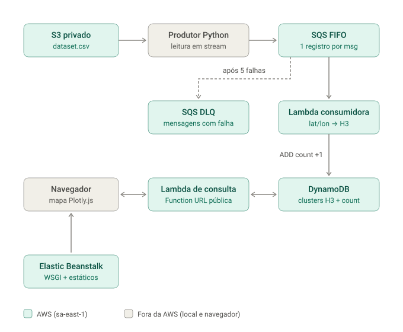

# Observatório INPE · H3

Pipeline de processamento geoespacial e visualização de focos de calor do INPE iniciado a partir de um dataset consolidado no **Amazon S3**, com streaming linha a linha para **SQS FIFO**, agregação hexagonal **H3** em **AWS Lambda**, persistência no **DynamoDB**, API pública via **Lambda Function URL** e mapa interativo em **Plotly.js** hospedado no **AWS Elastic Beanstalk**.

---

## Arquitetura (AWS `sa-east-1`)

A arquitetura começa a partir do CSV consolidado e ordenado cronologicamente no **S3** (`consolidated/dataset.csv`). A preparação prévia desse dataset a partir dos CSVs públicos do INPE é executada de forma independente pelo script utilitário [`scripts/scrape_inpe.py`](scripts/scrape_inpe.py).

[](arquitetura_ingestao_h3_mapa.svg)

### Fluxo dos dados

1. **Dataset consolidado no S3 (`consolidated/dataset.csv`):** arquivo CSV único com focos deduplicados e ordenados cronologicamente por `(date, id)`, contendo `id,date,satellite,latitude,longitude`.
2. **Produtor local em streaming ([`producer/main.py`](producer/main.py)):** abre o objeto diretamente do S3 como stream (`StreamingBody`), consome **linha a linha**, envia cada registro para a fila **SQS FIFO** (`MessageGroupId="inpe-chronological"`), aguarda `READ_INTERVAL_SECONDS` e só então lê a próxima linha — sem SQLite nem estado local.
3. **Fila SQS FIFO + DLQ:** desacopla a taxa de envio do processamento preservando a ordem cronológica. Mensagens que falham 5 vezes seguem para a DLQ.
4. **Lambda consumidora ([`consumer/handler.py`](consumer/handler.py)):** converte `(latitude, longitude)` na célula hexagonal **H3** (resolução configurada via `H3_RESOLUTION`, padrão `5`) e executa `UpdateItem` atômico no DynamoDB incrementando `count` para cada colisão naquele `(h3, satellite)`.
5. **DynamoDB:** cada cluster é armazenado de forma enxuta com `pk = CLUSTER`, `sk = H3#<hash>#SAT#<satelite>` e apenas os atributos `h3`, `satellite` e `count`.
6. **Lambda de consulta ([`backend/handler.py`](backend/handler.py) + [`backend/query.py`](backend/query.py)):** exposta via **Function URL** pública:
   - `GET /api/clusters` — consulta `pk = CLUSTER` com paginação (`cursor`, `limit`), filtro opcional por `satellite`, e retorna polígonos **GeoJSON** com `{h3, satellite, count}`.
   - `DELETE /api/clusters` — limpa todos os registros da tabela (acionável pelo botão **Limpar banco** na interface do mapa).
   - `GET /api/health` — verificação de saúde da API.
7. **Frontend ([`frontend/`](frontend/)) no AWS Elastic Beanstalk:** interface em tema claro com **Plotly.js (`choroplethmap`)** e estilos vetoriais (`Carto Positron`, `Carto Voyager`, `Carto Darkmatter`, `White BG`), escalas de cor (`Viridis`, `Plasma`, `YlOrRd`, `Cividis`), filtro por satélite, atualização automática a cada 5 segundos e botão para limpar o banco.

---

## Organização do repositório

```text
.
├── producer/        # Produtor/streamer S3 → SQS FIFO (linha a linha)
├── consumer/        # Lambda consumidora SQS FIFO → H3 → DynamoDB
├── backend/         # Lambda de consulta (Function URL) e servidor FastAPI local opcional
├── frontend/        # Mapa interativo Plotly.js (HTML, CSS e JS estáticos)
├── scripts/         # Utilitários: scraper avulso do INPE, empacotamento EB/Lambda e reset AWS
├── common/          # Contrato compartilhado (normalização CSV/UTC e carregamento de .env)
└── tests/           # Testes unitários, de contrato e integração simulada (pytest + Node)
```

| Pasta | Responsabilidade |
|---|---|
| `producer/` | Lê o CSV consolidado direto do S3 em stream linha a linha e envia para o SQS FIFO |
| `consumer/` | Calcula a célula H3 e incrementa `count` por `(h3, satellite)` no DynamoDB |
| `backend/` | API HTTP (`GET /api/clusters`, `DELETE /api/clusters`, `GET /api/health`) via Lambda Function URL |
| `frontend/` | Mapa interativo em Plotly.js com atualização automática, seletor de estilo/escala e limpeza do banco |
| `scripts/` | [`scrape_inpe.py`](scripts/scrape_inpe.py) (preparação avulsa do dataset no S3), [`build-eb-frontend.py`](scripts/build-eb-frontend.py) (ZIP para Elastic Beanstalk), empacotamento das Lambdas e [`reset_aws_data.py`](scripts/reset_aws_data.py) |

---

## Configuração (`.env`)

Copie [`.env.example`](.env.example) para `.env` na raiz do projeto e preencha suas variáveis (o `.env` é carregado automaticamente por `producer/main.py` e `scripts/scrape_inpe.py`, e ignorado pelo Git):

```bash
cp .env.example .env
```

Variáveis principais:

```dotenv
AWS_PROFILE=inpe-producer
AWS_DEFAULT_REGION=sa-east-1
S3_BUCKET=seu-bucket-s3
S3_KEY=consolidated/dataset.csv
SQS_QUEUE_URL=https://sqs.sa-east-1.amazonaws.com/CONTA/FILA.fifo
READ_INTERVAL_SECONDS=1
```

---

## Como executar

### 1. Ambiente virtual Python

```bash
python3 -m venv .venv
source .venv/bin/activate
python -m pip install -r producer/requirements.txt
```

### 2. Preparação avulsa do dataset no S3 *(executar uma única vez)*

```bash
python scripts/scrape_inpe.py
```

Opções úteis: `--max-files 6` (apenas os 6 arquivos mais recentes), `--prepare-only` (offline, sem upload ao S3) e `--reset` (limpa o cache local do scraper antes de baixar).

### 3. Iniciar o streaming S3 → SQS FIFO

```bash
python -m producer.main --start
```

Para ajustar a velocidade de envio na hora:

```bash
python -m producer.main --start --read-interval-seconds 0.1
```

### 4. Executar o mapa localmente

```bash
python3 -m http.server 8000 --directory frontend
```

Abra **http://localhost:8000** no navegador (certifique-se de que `frontend/config.js` aponta para a URL da sua Lambda de consulta e que a origem está liberada no CORS da Function URL).

### 5. Deploy do frontend no AWS Elastic Beanstalk

Gere o pacote ZIP (plataforma **Python 3.12**, sem dependências externas):

```bash
python3 scripts/build-eb-frontend.py --api-url 'https://SUA-ID.lambda-url.sa-east-1.on.aws/'
```

Faça upload de `dist/inpe-mapa-eb.zip` no console do **AWS Elastic Beanstalk** e adicione a URL gerada nas origens permitidas (**CORS**) da Function URL da Lambda de consulta (com métodos `GET` e `DELETE`).

---

## Testes

```bash
python -m pip install -r requirements-dev.txt
python3 -m pytest -q tests
node tests/test_map_data.js
node --check frontend/app.js
```
